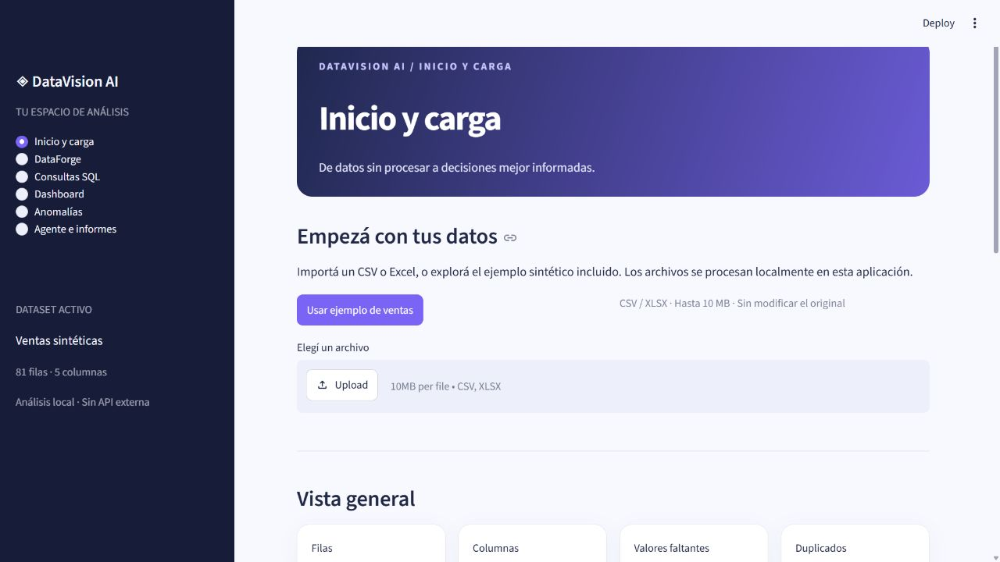
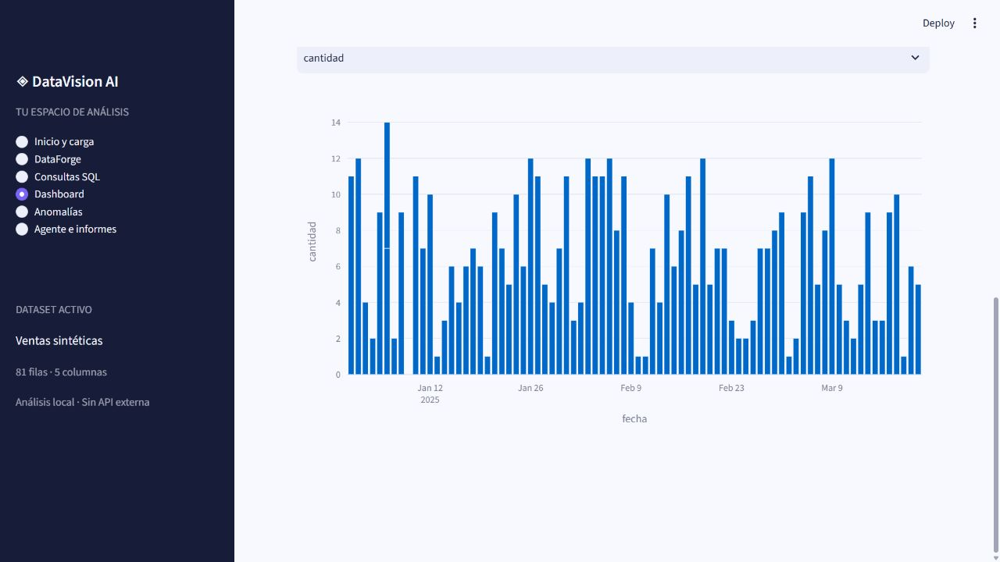
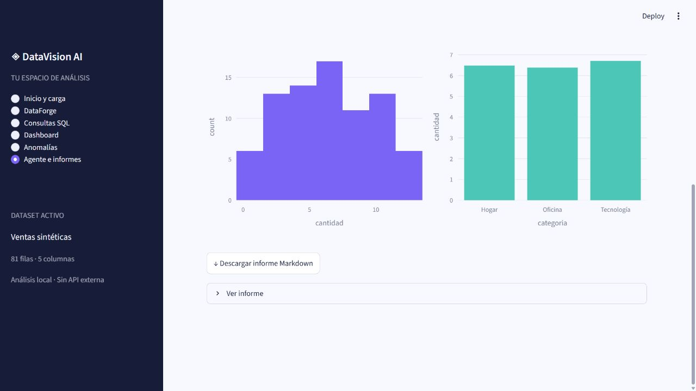

# ◈ DataVision AI

Una aplicación local en español para explorar, preparar y analizar datos tabulares. DataForge reúne operaciones explícitas de limpieza; DuckDB permite consultas acotadas y un flujo automatizado produce un informe reproducible. Diseñada para mostrar decisiones de ingeniería explicables en una entrevista.

## Vista previa

Capturas reales de la aplicación usando datos sintéticos incluidos en el proyecto.







## Requisitos e instalación

Python 3.11 (probado en Windows), Git opcional y conexión solo para instalar dependencias. Desde esta carpeta en PowerShell:

```powershell
py -3.11 -m venv .venv
.\.venv\Scripts\Activate.ps1
python -m pip install -r requirements.txt
python -m streamlit run app.py
```

En macOS/Linux: `python3.11 -m venv .venv`, `source .venv/bin/activate`, y los mismos comandos de instalación y ejecución. Si PowerShell bloquea la activación, ejecutá directamente `.\.venv\Scripts\python.exe -m streamlit run app.py`. Abrí la URL local indicada por Streamlit. El servidor está pensado para uso local confiable, no exposición pública.

## Recorrido

1. **Inicio y carga:** seleccioná el ejemplo de ventas o cargá CSV/XLSX (máximo 10 MB). Para CSV elegí separador y codificación; para Excel elegí hoja. La carga se confirma con el botón y una falla conserva los datos anteriores. Se muestra perfil, vista previa y duplicados.
2. **DataForge:** elegí una operación y aplicala. Se admiten duplicados, faltantes, relleno por valor/media/mediana/moda, conversión, renombrado, eliminación de columnas y filtros. Cada operación se calcula sobre una copia; si falla, no se guarda ningún cambio. Restablecer recupera el archivo cargado. Descargá el resultado en CSV.
3. **SQL:** consultá la tabla `datos`. Ejemplo: `SELECT categoria, SUM(cantidad) AS total FROM datos GROUP BY categoria ORDER BY total DESC`. La salida se limita a 1.000 filas y puede descargarse.
4. **Dashboard:** elegí filtro, columnas y tipo de gráfico. Las métricas son descriptivas; el texto temporal compara primer y último valor, sin atribuir causas.
5. **Anomalías:** seleccioná columnas numéricas y proporción esperada. Se requieren al menos 20 filas, valores válidos y variación. Los faltantes se imputan con mediana; Isolation Forest utiliza semilla 42. La puntuación más baja representa observaciones más inusuales. Una anomalía no demuestra error ni fraude.
6. **Agente e informes:** seleccioná ventas sintéticas o Iris y generá el informe Markdown y dos gráficos. Es un flujo de pasos fijos, no un agente general. La copia Iris viene con scikit-learn y funciona sin red.

## Datos de ejemplo y procedencia

`examples/ventas.csv` contiene 81 filas sintéticas, fechas, categorías, cantidades, precios y regiones; incluye faltantes, una fila duplicada y un precio atípico. `examples/ejemplo.xlsx` contiene las hojas Ventas y Categorias. No hay datos personales reales.

Iris es un conjunto público de Fisher, disponible en [UCI Machine Learning Repository](https://archive.ics.uci.edu/dataset/53/iris), con licencia [CC BY 4.0](https://creativecommons.org/licenses/by/4.0/). La aplicación usa la copia incluida en scikit-learn, que puede diferir de otras versiones; registra la fecha de análisis UTC en el informe. No descarga URL arbitrarias.

## Seguridad y límites de SQL

El editor usa un árbol sintáctico SQLGlot con lista restringida de construcciones, admite una sola sentencia SELECT y solo la tabla `datos`; DuckDB además desactiva acceso externo y carga/instalación automática de extensiones. No admite subconsultas, CTE, uniones ni funciones arbitrarias. La restricción reduce la superficie de acceso, pero no constituye un aislamiento de procesos ni garantiza seguridad ante usuarios no confiables o agotamiento de recursos. No expongas esta aplicación en una red pública. La consulta puede procesar más de 1.000 filas antes de limitar la salida.

## Pruebas

```powershell
python -m pytest -q
```

GitHub Actions instala las dependencias y ejecuta pytest al publicar. El entorno usa versiones acotadas, no un archivo de bloqueo; una instalación futura puede resolver versiones distintas. `config.toml` controla el tema y el límite de carga. Streamlit mantiene datos e historial solo durante la sesión; al reiniciar se pierden.

## Arquitectura

- `app.py`: navegación, estado y presentación.
- `datavision/io.py`: lectura y validación de archivos.
- `datavision/forge.py`: transformaciones atómicas.
- `datavision/sql.py`: restricciones y consultas DuckDB.
- `datavision/anomaly.py`: imputación e Isolation Forest.
- `datavision/report.py`: flujo controlado e informe por plantilla.
- `examples/`, `tests/`, `.streamlit/`, `.github/workflows/`: muestras, pruebas, configuración y CI.

Streamlit simplifica la interfaz; Pandas/NumPy manejan tablas, Plotly aporta interacción, DuckDB consulta en memoria y scikit-learn identifica patrones inusuales localmente. Las reglas son operaciones explícitas; las estadísticas resumen lo observado; el aprendizaje automático identifica patrones según supuestos. Ninguno es una API generativa: esta versión no integra una, no envía datos a proveedores de IA y no genera costos de API. Una futura integración requeriría configuración, consentimiento y evaluación de costos.

## Limitaciones y problemas frecuentes

CSV con formato o codificación incorrectos puede requerir otro separador o codificación. Excel dañado o vacío se rechaza. Los tipos se infieren y pueden requerir conversión; el filtrado usa una comparación por vez. Los gráficos muestran los datos en orden de entrada; para tendencias, convertí o elegí una fecha y revisá que los registros sean comparables. La imputación y proporción esperada influyen en el resultado del modelo. El informe contiene métricas y metodología; los dos gráficos se muestran en pantalla y no se incrustan en Markdown. El análisis es exploratorio, no asesoría ni predicción. No se implementó una API generativa; posibles mejoras: adjuntar gráficos al informe, deshacer pasos individuales, fijar dependencias y aislar SQL en un proceso con límites de recursos.

## Guion para entrevista

Cargá ventas, señalá faltantes y duplicados; quitá duplicados y rellená el precio con mediana, explicando que se conserva el original. Ejecutá el SQL de ejemplo, mostrás un gráfico y luego Isolation Forest, aclarando que señala rarezas, no fraude. Generá el informe Iris sin conexión y explicá la separación entre DataForge, consulta, análisis y presentación. Terminá con las pruebas y límites del editor SQL.
